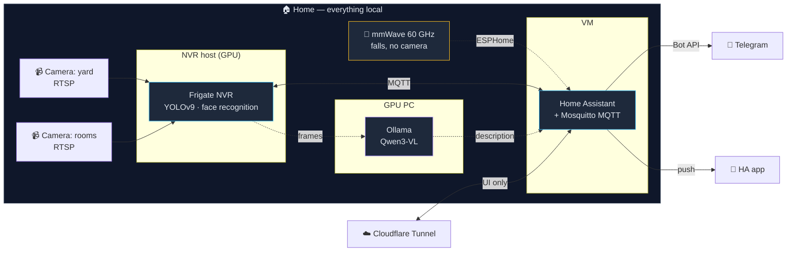

<div align="center">

# Engineer Against Dementia

**A local video monitoring and alerting system for caring for elderly relatives.**
No cloud. No subscriptions. All data stays in the house.

[](LICENSE)


[Русский](README.md) · [English](README.en.md) · [עברית](README.he.md)

</div>

---

## Why this exists

My grandfather lives with dementia. The main risk is that he walks out of
the house and can't find his way back. My father lives with schizophrenia;
getting out of bed at night is an early sign that his condition is
deteriorating.

Commercial solutions for this either don't exist, or they require sending
video from my parents' bedroom to somebody else's server for a monthly
fee. Neither option worked for me.

This is the system I built in my own home. It runs on my own hardware,
sends nothing outside, and messages me on Telegram when something happens
that should wake me up.

**This is not a medical device.** It does not diagnose, does not treat,
and does not replace human care. It shortens the time between "something
happened" and "I found out about it".

---

## What already works

- 🚪 **Leaving-the-house alert** — person in the gate zone → Telegram notification within seconds, with a snapshot
- 👤 **Face recognition** — tells family members from strangers, doesn't raise an alarm on our own people
- 🌙 **Night activity monitoring** — "bed / bedroom / kitchen" zones with separate logic
- 📹 **Local recording** — 7 days, motion-triggered, on my own disk
- 🔔 **Loud notifications** — full-screen alert on the phone, bypassing silent mode
- 🌐 **Remote access** — via Cloudflare Tunnel, no ports forwarded to the outside
- ♻️ **Self-healing** — a health check brings crashed services back up with no human involved

## What's in progress

- 🤸 Fall detection (60 GHz mmWave sensor for private areas + pose estimation)
- 🧠 A vision LLM that describes in words what the person is doing
- 📊 Building up "usual / unusual" patterns and a daily summary
- 🔊 Voice announcements through a smart speaker

Details: [roadmap](docs/en/09-roadmap.md).

---

## Architecture



**Video never leaves the house.** The only things that go out are the
notification text and, on request, a single frame into a protected chat.
Cloudflare Tunnel gives access to the interface, not to the video stream.

Component breakdown: [docs/en/01-architecture.md](docs/en/01-architecture.md)

---

## Stack

| Layer | What it's built on |
|---|---|
| Video analytics | [Frigate NVR](https://frigate.video/) 0.17, ONNX detector, YOLOv9-s |
| Automation | [Home Assistant](https://www.home-assistant.io/) OS in a VM |
| Event bus | Mosquitto MQTT |
| Notifications | Telegram Bot API + HA Companion push |
| Vision LLM | Ollama + Qwen3-VL 8B on a separate GPU |
| External access | Cloudflare Tunnel |
| Camera-free sensors | Seeed MR60FDA2 (60 GHz mmWave) via ESPHome |

---

## Repository layout

```
frigate/        NVR config: cameras, zones, detection thresholds
homeassistant/  automations and alerting rules
models/         YOLOv9 build to ONNX
services/       vision LLM and helper services
ops/            health check, systemd, tunnel — the things that keep the system alive
docs/           documentation (ru / en / he)
site/           project website
```

---

## Quick start

Full instructions: [docs/en/03-install.md](docs/en/03-install.md)

```bash
git clone https://github.com/nisonengineer-lab/engineer-against-dementia.git
cd engineer-against-dementia/frigate

cp .env.example .env                  # camera and MQTT credentials
cp config.example.yaml config.yaml    # zones are drawn for your own house in the UI

../models/yolov9/build.sh s 320       # build the detector
docker compose up -d
```

The zones and masks in `config.example.yaml` come from one specific
installation. Copying somebody else's coordinates is pointless — draw
your own in **Settings → Mask & Zone Editor**.

---

## Documentation

| | |
|---|---|
| [Overview](docs/en/00-overview.md) | Why, for whom, principles |
| [Architecture](docs/en/01-architecture.md) | Components and data flows |
| [Hardware](docs/en/02-hardware.md) | What's installed, what was rejected and why |
| [Installation](docs/en/03-install.md) | Deploying from scratch |
| [Configuration](docs/en/04-configuration.md) | Zones, thresholds, masks |
| [Alerts](docs/en/05-alerts.md) | Telegram, HA automations |
| [AI models](docs/en/06-ai-models.md) | Detection, faces, vision LLM |
| [Troubleshooting](docs/en/07-troubleshooting.md) | Real bugs and how they were fixed |
| [Decisions (ADR)](docs/en/08-decisions.md) | **What was tried and abandoned** |
| [Roadmap](docs/en/09-roadmap.md) | What's next |

The "Decisions" section is the most useful one. It holds the dead ends I
already walked into, with the reasons. It will save you more time than
the installation guide.

---

## Privacy and security

- Video and face recognition run **on local hardware only**, no cloud
- The repository contains **no** real passwords, IPs, tokens, frames or faces
- The only thing exposed outside is a Cloudflare Tunnel to the web interface; no ports are forwarded on the router
- Recordings are kept for 7 days and deleted automatically

Found a security problem — [SECURITY.md](SECURITY.md).

**Consent.** Filming people in their own home is not a technical
question. Every family member who appears on camera knows about the
system and has agreed to it. Areas where a camera is inappropriate (the
bedroom) are covered by a mmWave sensor with no video. If you deploy this
at home — do the same.

---

## License

[AGPL-3.0](LICENSE) © Nias Adamov

The code is open. If you build a networked service on top of it, your
code has to be open too.

---

<div align="center">

**[engineeragainstdementia.net](https://engineeragainstdementia.net)**

Built in Yavne, Israel — for my grandfather, my father and my grandmother.

</div>
