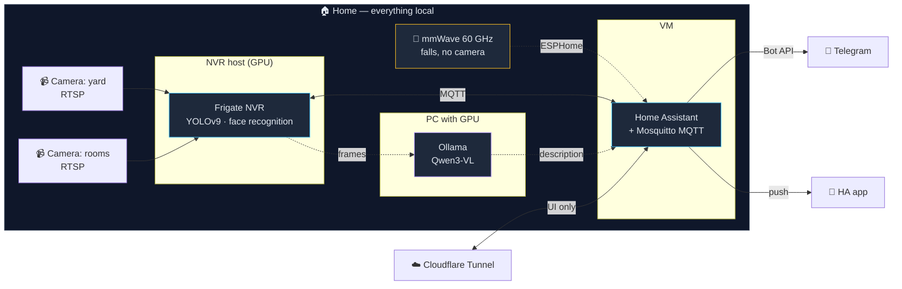

<div align="center">

# Engineer Against Dementia

**מערכת מקומית לניטור וידאו והתראות לטיפול בקרובי משפחה מבוגרים.**
בלי ענן. בלי מנויים. כל הנתונים נשארים בבית.

[](LICENSE)


[Русский](README.md) · [English](README.en.md) · [עברית](README.he.md)

</div>

---

## למה זה

סבא שלי חי עם דמנציה. הסיכון העיקרי — הוא יוצא מהבית ולא מוצא את הדרך
חזרה. אבא שלי חי עם סכיזופרניה; יציאה מהמיטה בלילה היא סימן מוקדם לכך
שהמצב מידרדר.

פתרונות מסחריים לזה או שלא קיימים, או שהם דורשים לשלוח וידאו מחדר השינה
של ההורים לשרת של מישהו אחר תמורת תשלום חודשי. אף אחת משתי האפשרויות לא
התאימה לי.

זו מערכת שבניתי אצלי בבית. היא רצה על החומרה שלי, לא שולחת שום דבר
החוצה, ושולחת לי הודעה ב-Telegram כשקורה משהו שאמור להעיר אותי.

**זה לא מכשיר רפואי.** היא לא מאבחנת, לא מטפלת ולא מחליפה טיפול של אדם.
היא מקצרת את הזמן שבין «קרה משהו» לבין «נודע לי על זה».

---

## מה כבר עובד

- 🚪 **התראה ביציאה מהבית** — אדם באזור השער → התראה ב-`Telegram` תוך שניות, עם תמונה
- 👤 **זיהוי פנים** — מבחין בין בני המשפחה לזרים, לא מרים התראה על מוכרים
- 🌙 **מעקב אחר פעילות לילית** — אזורים «מיטה / חדר שינה / מטבח» עם לוגיקה נפרדת
- 📹 **הקלטה מקומית** — 7 ימים לפי תנועה, על הדיסק שלי
- 🔔 **התראות רועשות** — התראה במסך מלא בטלפון, עוקפת מצב שקט
- 🌐 **גישה מרחוק** — דרך `Cloudflare Tunnel`, בלי פתיחת פורטים החוצה
- ♻️ **התאוששות עצמית** — health-check מרים שירותים שנפלו בלי מעורבות של אדם

## מה בעבודה

- 🤸 זיהוי נפילות (חיישן `mmWave` 60 GHz לאזורים פרטיים + pose estimation)
- 🧠 `Vision-LLM` שמתארת במילים מה האדם עושה
- 📊 צבירת דפוסים «רגיל / לא רגיל» וסיכום יומי
- 🔊 התראה קולית דרך רמקול חכם

בפירוט: [מפת דרכים](docs/he/09-roadmap.md).

---

## ארכיטקטורה



**הווידאו לא יוצא מהבית.** החוצה יוצא רק טקסט ההתראה, ולפי בקשה — תמונה
בודדת לצ'אט מוגן. Cloudflare Tunnel נותן גישה לממשק, לא לזרם הווידאו.

פירוק הרכיבים: [docs/en/01-architecture.md](docs/en/01-architecture.md)

---

## סטאק

| שכבה | במה נעשה |
|---|---|
| אנליטיקת וידאו | [Frigate NVR](https://frigate.video/) 0.17, דיטקטור `ONNX`, `YOLOv9-s` |
| אוטומציה | [Home Assistant](https://www.home-assistant.io/) OS ב-VM |
| אפיק אירועים | `Mosquitto MQTT` |
| התראות | `Telegram Bot API` + `HA Companion` push |
| Vision-LLM | `Ollama` + `Qwen3-VL 8B` על GPU נפרד |
| גישה מבחוץ | `Cloudflare Tunnel` |
| חיישנים ללא מצלמה | `Seeed MR60FDA2` (60 GHz mmWave) דרך `ESPHome` |

---

## מבנה הריפוזיטורי

```
frigate/        NVR config: cameras, zones, detection thresholds
homeassistant/  automations and alerting rules
models/         YOLOv9 build to ONNX
services/       vision-LLM and helper services
ops/            health-check, systemd, tunnel — what keeps the system alive
docs/           documentation (ru / en / he)
site/           project website
```

---

## התחלה מהירה

הוראות מלאות: [docs/en/03-install.md](docs/en/03-install.md)

```bash
git clone https://github.com/nisonengineer-lab/engineer-against-dementia.git
cd engineer-against-dementia/frigate

cp .env.example .env                  # camera and MQTT credentials
cp config.example.yaml config.yaml    # zones are drawn for your own house in the UI

../models/yolov9/build.sh s 320       # build the detector
docker compose up -d
```

האזורים והמסכות ב-`config.example.yaml` שייכים להתקנה ספציפית. אין טעם
להעביר קואורדינטות של מישהו אחר — צייר את שלך ב-**Settings → Mask & Zone
Editor**.

---

## תיעוד

| | |
|---|---|
| [סקירה](docs/he/00-overview.md) | למה, בשביל מי, עקרונות |
| [ארכיטקטורה](docs/en/01-architecture.md) | רכיבים וזרימות נתונים |
| [חומרה](docs/he/02-hardware.md) | מה מותקן, מה נדחה ולמה |
| [התקנה](docs/en/03-install.md) | הקמה מאפס |
| [הגדרות](docs/en/04-configuration.md) | אזורים, ספים, מסכות |
| [התראות](docs/en/05-alerts.md) | `Telegram`, אוטומציות `HA` |
| [מודלי AI](docs/en/06-ai-models.md) | דיטקציה, פנים, `vision-LLM` |
| [אבחון תקלות](docs/en/07-troubleshooting.md) | באגים אמיתיים ואיך תוקנו |
| [החלטות (ADR)](docs/en/08-decisions.md) | **מה ניסינו וביטלנו** |
| [מפת דרכים](docs/he/09-roadmap.md) | מה הלאה |

הפרק «החלטות» הוא הכי שימושי. שם נמצאים המבואות הסתומים שכבר נכנסתי
אליהם, עם הסיבות. הוא יחסוך יותר זמן מאשר הוראות ההתקנה.

---

## פרטיות ואבטחה

- וידאו וזיהוי פנים — **רק על חומרה מקומית**, בלי שום ענן
- בריפוזיטורי **אין** אף סיסמה אמיתית, IP, טוקן, תמונה או פנים
- החוצה פתוח רק `Cloudflare Tunnel` אל ממשק הווב, אין פורטים פתוחים בראוטר
- ההקלטות נשמרות 7 ימים ונמחקות אוטומטית

מצאת בעיית אבטחה — [SECURITY.md](SECURITY.md).

**הסכמה.** צילום אנשים בבית שלהם הוא לא עניין טכני. כל בני המשפחה
שנכנסים לפריים יודעים על המערכת והסכימו לה. אזורים שבהם מצלמה לא במקומה
(חדר שינה) מכוסים בחיישן mmWave בלי וידאו. אם אתה מקים את זה אצלך — עשה
אותו דבר.

---

## רישיון

[AGPL-3.0](LICENSE) © Nias Adamov

הקוד פתוח. אם אתה בונה עליו שירות רשת — גם הקוד שלך חייב להיות פתוח.

---

<div align="center">

**[engineeragainstdementia.net](https://engineeragainstdementia.net)**

נבנה ביבנה, ישראל — בשביל סבא, אבא וסבתא.

</div>
