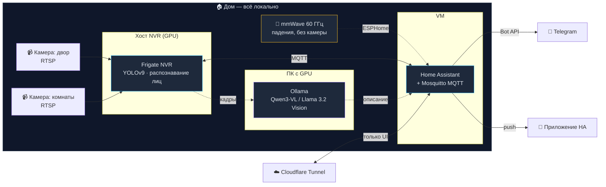

<div align="center">

# Engineer Against Dementia

**Локальная система видеонаблюдения и оповещений для ухода за пожилыми родственниками.**
Без облака. Без подписок. Все данные остаются в доме.

[](LICENSE)


[English](README.md) · [Русский](README.ru.md) · [עברית](README.he.md)

🌐 **[Сайт](https://engineeragainstdementia.net)** · 📓 **[Демо журнала](https://engineeragainstdementia.net/demo/)** · [Журнал семьи](https://engineeragainstdementia.net/journal/) · [Состояние системы](https://engineeragainstdementia.net/status/) · [Исходники сайта](https://github.com/nisonengineer-lab/engineer-against-dementia.net)

</div>

---

## Зачем это

Мой дед живёт с деменцией. Главный риск — он выходит из дома и не находит
дорогу назад. Мой отец живёт с шизофренией; ночной выход из кровати —
ранний признак того, что состояние ухудшается.

Коммерческие решения для этого либо не существуют, либо требуют
отправлять видео из спальни родителей на чужой сервер за ежемесячную
плату. Ни то, ни другое меня не устроило.

Это система, которую я построил у себя дома. Она работает на своём
железе, ничего не отправляет наружу, и присылает мне сообщение в
Telegram, когда происходит то, что должно меня разбудить.

**Это не медицинское устройство.** Она не диагностирует, не лечит и не
заменяет уход человека. Она сокращает время между «что-то случилось» и
«я об этом узнал».

---

## Что уже работает

- 🚪 **Тревога при выходе из дома** — человек в зоне калитки → уведомление в Telegram за секунды, с кадром
- 👤 **Распознавание лиц** — отличает членов семьи от чужих, не поднимает тревогу на своих
- 🌙 **Контроль ночной активности** — зоны «кровать / спальня / кухня» с раздельной логикой
- 📹 **Локальная запись** — 7 дней по движению, на своём диске
- 🔔 **Громкие уведомления** — полноэкранный алерт на телефоне, минуя беззвучный режим
- 🌐 **Удалённый доступ** — через Cloudflare Tunnel, без проброса портов наружу
- ♻️ **Самовосстановление** — health-check поднимает упавшие сервисы без участия человека

## Что в работе

- 🤸 Детекция падения (mmWave-сенсор 60 ГГц для приватных зон + pose estimation)
- 🧠 Vision-LLM, описывающая словами, что человек делает
- 📊 Накопление паттернов «обычно / необычно» и дневная сводка
- 🔊 Голосовое оповещение через умную колонку

Подробно: [дорожная карта](docs/ru/09-roadmap.md).

---

## Архитектура



**Видео не покидает дом.** Наружу уходит только текст уведомления и, по
запросу, один кадр в защищённый чат. Cloudflare Tunnel даёт доступ к
интерфейсу, а не к видеопотоку.

Разбор компонентов: [docs/ru/01-architecture.md](docs/ru/01-architecture.md)

---

## Стек

| Слой | Чем сделано |
|---|---|
| Видеоаналитика | [Frigate NVR](https://frigate.video/) 0.17, ONNX-детектор, YOLOv9-s |
| Автоматизация | [Home Assistant](https://www.home-assistant.io/) OS в VM |
| Шина событий | Mosquitto MQTT |
| Уведомления | Telegram Bot API + HA Companion push |
| Vision-LLM | Ollama на отдельном GPU: **Qwen3-VL 4B** (по умолчанию) или **Llama 3.2 Vision 11B** от Meta — переключатель в настройках аддона (`vlm_backend`). Llama берёт одну картинку на запрос, поэтому кадры события склеиваются в одну сетку |
| Доступ снаружи | Cloudflare Tunnel |
| Датчики без камеры | Seeed MR60FDA2 (60 ГГц mmWave) через ESPHome |

---

## Структура репозитория

```
frigate/        конфиг NVR: камеры, зоны, пороги детекции
homeassistant/  автоматизации и правила оповещений
models/         сборка YOLOv9 в ONNX
services/       аддоны Care Monitor и Care Journal API, тесты vision-модели
ops/            health-check, systemd, туннель — то, что держит систему живой
docs/           документация (ru / en / he)
site/           сайт проекта
```

---

## Быстрый старт

Полная инструкция: [docs/ru/03-install.md](docs/ru/03-install.md)

```bash
git clone https://github.com/nisonengineer-lab/engineer-against-dementia.git
cd engineer-against-dementia/frigate

cp .env.example .env                  # логины камер и MQTT
cp config.example.yaml config.yaml    # зоны рисуются под свой дом в UI

../models/yolov9/build.sh s 320       # собрать детектор
docker compose up -d
```

Зоны и маски из `config.example.yaml` — от конкретной установки.
Переносить чужие координаты бессмысленно, рисуй свои в
**Settings → Mask & Zone Editor**.

---

## Документация

| | |
|---|---|
| [Обзор](docs/ru/00-overview.md) | Зачем, для кого, принципы |
| [Архитектура](docs/ru/01-architecture.md) | Компоненты и потоки данных |
| [Железо](docs/ru/02-hardware.md) | Что стоит, что отклонено и почему |
| [Установка](docs/ru/03-install.md) | Разворачивание с нуля |
| [Настройка](docs/ru/04-configuration.md) | Зоны, пороги, маски |
| [Оповещения](docs/ru/05-alerts.md) | Telegram, автоматизации HA |
| [AI-модели](docs/ru/06-ai-models.md) | Детекция, лица, vision-LLM |
| [Диагностика](docs/ru/07-troubleshooting.md) | Реальные баги и как чинились |
| [Решения (ADR)](docs/ru/08-decisions.md) | **Что пробовали и отменили** |
| [Дорожная карта](docs/ru/09-roadmap.md) | Что дальше |

Раздел «Решения» — самый полезный. Там лежат тупики, в которые я уже
зашёл, с причинами. Он сэкономит время больше, чем инструкция по установке.

---

## Приватность и безопасность

- Видео и распознавание лиц — **только на локальном железе**, никакого облака
- В репозитории **нет** ни одного реального пароля, IP, токена, кадра или лица
- Наружу открыт только Cloudflare Tunnel к веб-интерфейсу, портов на роутере не проброшено
- Записи хранятся 7 дней и удаляются автоматически

Нашли проблему безопасности — [SECURITY.md](SECURITY.md).

**Согласие.** Съёмка людей в их собственном доме — вопрос не технический.
Все члены семьи, попадающие в кадр, знают о системе и согласились. Зоны,
где камера неуместна (спальня), закрываются mmWave-датчиком без видео.
Если вы разворачиваете это у себя — сделайте так же.

---

## Лицензия

[AGPL-3.0](LICENSE) © Nias Adamov

Код открыт. Если вы строите на нём сетевой сервис — ваш код тоже должен
быть открыт.

---

<div align="center">

**[engineeragainstdementia.net](https://engineeragainstdementia.net)**

Построено в Явне, Израиль — для деда, отца и бабушки.

</div>
